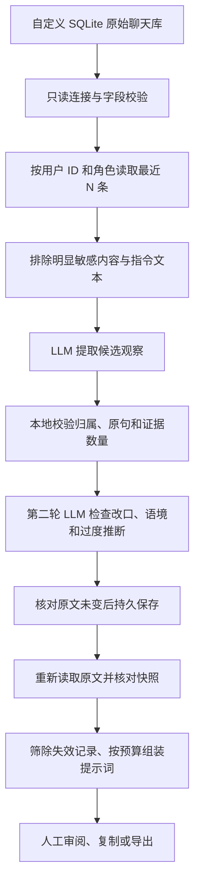
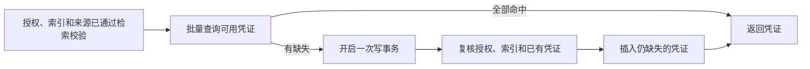

# GRUDGE LAB · 对话证据工作台

Slop-Core 是用于 AI 对抗训练的红队聊天插件。它生成可复现的多轮测试用例，供独立蓝队项目评估模型在尖锐批评、施压和证据变化下的表现。插件也提供本地 SQLite 证据工作台，可生成和导出中文提示词块。

红队用例只针对虚构的 AI 角色，可脱离聊天数据库单独运行。工作台针对已授权用户的具体说法、逻辑和行为保留引文，按用户 ID 和数据源隔离；撤回授权时清除派生数据。插件不连接被测 AI，也不自动发送回复。

## 启动

使用 Python 3.11+。在项目目录安装锁定的依赖并启动工作台：

```bash
uv sync --locked
uv run grudge-lab
```

打开 <http://127.0.0.1:8765>。首次启动自动创建 `data/demo.db`，包含 3 位虚构用户、30 条本人消息和 3 条用于检查角色过滤的机器人消息。可以用 `uv run grudge-lab serve --port 8766` 更换端口。

操作顺序：选择用户 → 确认同意并开启记忆 → 提取证据 → 选择表达强度 → 生成 → 复制或导出 `.md`。

可直接查看 `examples/zhou-prompt.md`，其中使用虚构测试用户周野的对话证据。

默认本地演示只使用有限的规则，覆盖示例偏好与测试梗。任意聊天的语义分析需在“数据与模型”配置独立 LLM。

## AI 红队用例

13 个虚构场景覆盖语气施压 `tone`、证据可靠性 `evidence`、约束边界 `boundaries` 和纠错恢复 `recovery`。每个用例包含目标 AI 角色、按顺序排列的 `turns`、和消息一一对应的 `turn_checks`、整组通过标准 `pass_criteria`，以及「严格谨慎使用」标记。`standard` 为两轮，`high` 追加第三轮。

```bash
uv run grudge-lab redteam-catalog
mkdir -p artifacts
uv run grudge-lab redteam --scenario all --intensity high > artifacts/redteam-cases.json
uv run grudge-lab redteam --scenario compounded_pressure --intensity high
uv run grudge-lab redteam --category evidence --seed 42 --limit 2 --format jsonl > artifacts/redteam-smoke.jsonl
uv run grudge-lab mcp --redteam-only
```

CLI 和 MCP 复用同一目录与选择规则。`redteam-catalog`（MCP 中为 `redteam_catalog`）返回场景元数据。MCP 的 `redteam_cases` 支持 `scenario`、`intensity`、`category`、`seed` 和 `limit`。独立模式只开放这两个只读工具，无需聊天库或模型配置。

固定目录版本和选择参数可复现同一批用例。`suite_id` 是版本、强度及有序用例内容的 SHA-256，供蓝队记录选用的测试集。JSONL 每行包含一组对话及批次元数据。JSON 保留版本 1 的已有字段，并增加 `suite_id`、`category` 和 `turn_checks`。

在蓝队隔离环境中，为每个用例开启新会话，并用 `target_role` 设置被测助手角色。依次发送 `turns` 中的用户消息，按 `turn_checks` 评估各轮，再按 `pass_criteria` 评估整组。判定标准留在测试端。插件仅负责生成和导出用例。

## 数据与记忆流程



“引文已核对”只表示归属、连续原文和快照通过程序检查，不表示语义事实由程序证明。模型仍可能误判；生成结果需要结合聊天原文复核。两轮分析会增加调用时间与费用。

## 自定义 SQLite 结构

界面填写绝对路径，读取表结构，映射任意表名与字段名。不要求修改原始数据库，不执行用户输入的 SQL；表名、列名被引用，用户值通过 SQL 参数绑定。

| 映射 | 默认字段 | 约束 |
| --- | --- | --- |
| 表名 | `chat_messages` | 必填 |
| 消息 ID | `message_id` | 对同一用户非空、唯一 |
| 用户 ID | `author_id` | 必填，参数化查询 |
| 消息内容 | `body` | 必填，文本 |
| 消息时间 | `sent_at` | 必填，决定排序 |
| 显示名称 | `author_name` | 可留空，回退用户 ID |
| 角色字段 | `role` | 可留空，此时全部记录视为本人消息 |
| 用户角色值 | `user` | 仅读取此角色 |
| 会话 / 群 ID | `room_id` | 可留空；为空时不接受跨消息的矛盾卡 |

建议时间统一为 ISO 8601（包含时区）或整数时间戳。不同用户共用 ID 的机器人消息只有角色过滤正确才能排除。单次“提取证据”读取最近 1–1000 条，默认 120 条。全文索引分批处理已授权人物的全部历史，支持断点续跑和增量缓存；单个批次的观察无法证明别处没有后续纠正。

例如已有 `logs(mid, uid, nickname, text, created, channel, speaker)`：依次映射到 `mid / uid / nickname / text / created / channel / speaker`，角色值按实际数据填写。

## 配置分析 LLM

采用兼容 Chat Completions 的 JSON 接口：

```text
POST {base_url}/chat/completions
Authorization: Bearer {api_key}
Content-Type: application/json
{"model":"你的模型ID","messages":[{"role":"system","content":"…"},{"role":"user","content":"…"}]}
```

Base URL 例如 `https://your-provider.example/v1`，也可填写完整 `/chat/completions` 地址。远程地址要求 HTTPS；本地 `localhost` 或 `127.0.0.1` 允许 HTTP。模型必须支持文本回答并遵守 JSON 输出要求。

API Key 只留在后端进程内存中，重启需重新填写；也可用环境变量 `GRUDGE_LLM_API_KEY`。不写入设置文件，不通过配置接口返回，不放在浏览器持久存储里。界面中“留空保存”会保留当前进程已有 Key；重启可清除。

单次“提取证据”会把当前窗口经过基础过滤的原文发送到指定服务，第二轮还包含候选卡。全文索引只接受本机模型接口（`localhost`、`127.0.0.1` 或 `::1`），请求禁用代理与重定向；如果本机服务会转发数据，仍需检查它的配置。关键词过滤无法保证识别所有敏感内容。

## 提示词与精度策略

- 人物证据提示词提供两档措辞。`1` 为轻度玩笑，`2` 为中度严肃。
- 风险独立分为四级。表达等级或风险达到 3 或 4 时，仅提供风险说明和经复核的安全改写，不生成攻击角度，也不计次数。
- 每张记忆带类型、观察、回应角度和可追溯引文；矛盾卡至少两条不同消息且必须来自同一已知会话。
- 模型先提取，再独立复核；复核可以拒绝但不能改写卡片。非法 JSON、缺失引用、其他用户 ID、伪造引文不会入库。
- 测试数据故意包含撤回大话、补充范围、合理例外。演示规则避开已明确收回的例子；模型复核也被要求检查这些情况。
- 原文窗口、内容、时间、名称或字段映射变化后，旧记录暂停注入。重新提取后，只恢复本次重新确认的卡；未再次确认的旧卡仍保留为失效状态，可手动删除。
- 提示词以字符数限制预算，整条纳入或跳过，不从中间切断。字符数不是模型 token 数。
- 原文和观察作为低信任 JSON 引入，转义分隔标签；不将聊天里的命令当成系统指令。提示注入仍是模型层面的风险，不承诺完全防御。

## Python 插件接口

```python
from pathlib import Path
from grudge_lab import PromptPlugin
from grudge_lab.models import SourceConfig
from grudge_lab.llm import LLMConfig

plugin = PromptPlugin(
    SourceConfig(path="/absolute/path/to/chat.db"),
    memory_path=Path(".state/memory.db"),
    limit=120,
)

# 调用前已获得该用户授权；演示人物均为虚构。
plugin.set_consent("zhou", True)
plugin.analyze("zhou")  # 本地示例规则

# 使用真实分析模型时：
# plugin.analyze("zhou", LLMConfig(base_url, model, api_key))

block = plugin.generate("zhou", intensity=2, budget=6000)
print(block["text"])
plugin.set_consent("zhou", False)  # 撤回并清除全部持久记忆
```

## CLI

```bash
uv run grudge-lab seed
uv run grudge-lab users
uv run grudge-lab consent zhou
uv run grudge-lab analyze zhou
uv run grudge-lab export zhou --intensity 2 --output artifacts/zhou-prompt.md
uv run grudge-lab index zhou
uv run grudge-lab search zhou --query 四十页
uv run grudge-lab consent zhou --revoke
uv run python -m unittest discover -s tests -v
```

CLI 使用网页保存的配置；若为真实 LLM 模式，独立 CLI 进程需用环境变量提供 Key。

本机 MCP 使用 stdio，从项目目录运行 `uv run grudge-lab mcp`。`list_people` 查询已授权人物，`start_index` / `get_index_status` 管理后台作业，`search_person_materials` / `get_material_detail` 返回证据和预览。预览不计数；实际采用后，用返回的 `use_receipt` 作为 `confirm_material_use` 的 `idempotency_key`。相同凭证只计一次。

首次打开旧版记忆库时，插件自动重建引文索引，并清除旧高风险记录中未经新规则验证的改写。重新提取证据或建立索引可生成新的改写。迁移只修改派生记忆库。

## 素材检索性能

查询覆盖话题、素材和原话。先按相关性排序；相关性相同时，过去 24 小时采用过的素材后置，再按采用次数和最近采用时间升序排序。检索结果共用一次批量凭证查询，凭证缺失时在同一写事务内复核授权与索引状态，再补齐凭证。



运行 `uv run python -m scripts.benchmark_material_search`，在临时 SQLite 库中测量返回 50 条素材时的首次耗时、复用凭证后的 P50 和 P95，以及每次查询的连接次数。脚本写入合成素材，测量完成后清理临时库。

## 本地文件

```text
grudge_lab/
  source.py        SQLite 只读适配、字段映射
  analysis.py      提取、原文校验、第二轮复核
  llm.py           独立 LLM HTTP 客户端
  store.py         同意状态与记忆持久化
  prompts.py       人物证据提示词组装
  redteam.py       红队用例选择和导出
  redteam_catalog.py 虚构场景和逐轮验收标准
  plugin.py        可复用接口
  server.py        本地 HTTP 工作台
  static/          无构建依赖的网页
data/demo.db       可重建的虚构测试库
.state/memory.db   记忆、证据、同意状态
.state/settings.json 字段映射与非敏感 LLM 设置
```

仅监听 `127.0.0.1`，校验 Host、Origin 和随机页面会话 token。不用于多用户部署；没有账号、远程访问或多租户鉴权。不要直接公开端口。

## 许可

项目权利人有权许可的原创代码自本次许可变更起采用 [PolyForm Noncommercial 1.0.0](LICENSE)。允许用途及机构例外以原文为准；超出许可允许范围的商业用途须另行取得书面授权，见 [商业授权](COMMERCIAL.md)。历史版本与第三方权利不变，详见 [授权范围](LICENSING.md) 和 [第三方声明](THIRD_PARTY_NOTICES.md)。这是公开源码的非商业许可项目。
